<!-- Generated by `mise run readme` from profile/. Edit that, not this. -->

Regenerated every day by <code>mise run readme</code> (<a href="profile/">source</a>). Console design and contribution city by <a href="https://github.com/georgekobaidze/georgekobaidze">Giorgi Kobaidze</a> (<a href="https://dev.to/georgekobaidze/i-turned-my-github-profile-into-a-cyberpunk-console-with-a-city-built-from-my-contributions-h4c">how he built it</a>), used under MIT. Install lines after <a href="https://github.com/jdx">@jdx</a>.

