<!-- Generated by `mise run readme` from profile/. Edit that, not this. -->

<picture><source media="(max-width: 600px)" srcset="https://github.com/alexey1312/alexey1312/raw/main/assets/phone/header.svg"></picture>
<picture><source media="(max-width: 600px)" srcset="https://github.com/alexey1312/alexey1312/raw/main/assets/phone/links.svg"></picture>
<a href="https://blog.kakoulin.com"><picture><source media="(max-width: 600px)" srcset="https://github.com/alexey1312/alexey1312/raw/main/assets/phone/links/blog.svg"></picture></a><a href="https://www.linkedin.com/in/alexey1312/"><picture><source media="(max-width: 600px)" srcset="https://github.com/alexey1312/alexey1312/raw/main/assets/phone/links/linkedin.svg"></picture></a><a href="https://t.me/akakoulin"><picture><source media="(max-width: 600px)" srcset="https://github.com/alexey1312/alexey1312/raw/main/assets/phone/links/telegram.svg"></picture></a><a href="mailto:me@kakoulin.com"><picture><source media="(max-width: 600px)" srcset="https://github.com/alexey1312/alexey1312/raw/main/assets/phone/links/mail.svg"></picture></a>
<picture><source media="(max-width: 600px)" srcset="https://github.com/alexey1312/alexey1312/raw/main/assets/phone/stats.svg"></picture>
<picture><source media="(max-width: 600px)" srcset="https://github.com/alexey1312/alexey1312/raw/main/assets/phone/contribution-city.svg"></picture>
<picture><source media="(max-width: 600px)" srcset="https://github.com/alexey1312/alexey1312/raw/main/assets/phone/projects.svg"></picture>
<a href="https://designpipe.github.io/exfig/"><picture><source media="(max-width: 600px)" srcset="https://github.com/alexey1312/alexey1312/raw/main/assets/phone/projects/exfig.svg"></picture></a><a href="https://github.com/ldomaradzki/xcsift"><picture><source media="(max-width: 600px)" srcset="https://github.com/alexey1312/alexey1312/raw/main/assets/phone/projects/xcsift.svg"></picture></a>
<a href="https://github.com/alexey1312/iPhone-Duo-Agent-Skill"><picture><source media="(max-width: 600px)" srcset="https://github.com/alexey1312/alexey1312/raw/main/assets/phone/projects/iphone-duo-agent-skills.svg"></picture></a><a href="https://foldy.proteinunit.dev"><picture><source media="(max-width: 600px)" srcset="https://github.com/alexey1312/alexey1312/raw/main/assets/phone/projects/foldy.svg"></picture></a>
<a href="https://github.com/alexey1312/reachy-mini-swift"><picture><source media="(max-width: 600px)" srcset="https://github.com/alexey1312/alexey1312/raw/main/assets/phone/projects/reachy-mini-swift.svg"></picture></a><a href="https://github.com/alexey1312/SnapshotTestingHEIC"><picture><source media="(max-width: 600px)" srcset="https://github.com/alexey1312/alexey1312/raw/main/assets/phone/projects/snapshottestingheic.svg"></picture></a>
<a href="https://github.com/alexey1312/swift-index"><picture><source media="(max-width: 600px)" srcset="https://github.com/alexey1312/alexey1312/raw/main/assets/phone/projects/swiftindex.svg"></picture></a><a href="https://github.com/alexey1312/clai"><picture><source media="(max-width: 600px)" srcset="https://github.com/alexey1312/alexey1312/raw/main/assets/phone/projects/clai.svg"></picture></a>
<a href="https://github.com/alexey1312/Swift-Charts-Agent-Skill"><picture><source media="(max-width: 600px)" srcset="https://github.com/alexey1312/alexey1312/raw/main/assets/phone/projects/also-swift-charts-skill.svg"></picture></a><a href="https://github.com/alexey1312/Swift-Android-Agent-Skill"><picture><source media="(max-width: 600px)" srcset="https://github.com/alexey1312/alexey1312/raw/main/assets/phone/projects/also-swift-android-skill.svg"></picture></a><a href="https://github.com/alexey1312/Vibe-Editing-Agent-Skill"><picture><source media="(max-width: 600px)" srcset="https://github.com/alexey1312/alexey1312/raw/main/assets/phone/projects/also-vibe-editing-skill.svg"></picture></a><a href="https://github.com/alexey1312/System-Design-Agent-Skill"><picture><source media="(max-width: 600px)" srcset="https://github.com/alexey1312/alexey1312/raw/main/assets/phone/projects/also-system-design-skill.svg"></picture></a>
<a href="https://github.com/alexey1312/Laner"><picture><source media="(max-width: 600px)" srcset="https://github.com/alexey1312/alexey1312/raw/main/assets/phone/projects/also-laner.svg"></picture></a><a href="https://github.com/alexey1312/baton"><picture><source media="(max-width: 600px)" srcset="https://github.com/alexey1312/alexey1312/raw/main/assets/phone/projects/also-baton.svg"></picture></a><a href="https://github.com/alexey1312/ruen-sync-mac"><picture><source media="(max-width: 600px)" srcset="https://github.com/alexey1312/alexey1312/raw/main/assets/phone/projects/also-ruen-sync-mac.svg"></picture></a><a href="https://apps.apple.com/kz/app/realy/id1485012603"><picture><source media="(max-width: 600px)" srcset="https://github.com/alexey1312/alexey1312/raw/main/assets/phone/projects/also-realy.svg"></picture></a>
<picture><source media="(max-width: 600px)" srcset="https://github.com/alexey1312/alexey1312/raw/main/assets/phone/releases.svg"></picture>
<a href="https://github.com/alexey1312/Vibe-Editing-Agent-Skill/releases/tag/v1.0.0"><picture><source media="(max-width: 600px)" srcset="https://github.com/alexey1312/alexey1312/raw/main/assets/phone/releases/1.svg"></picture></a>
<a href="https://github.com/alexey1312/iPhone-Duo-Agent-Skill/releases/tag/v1.4.2"><picture><source media="(max-width: 600px)" srcset="https://github.com/alexey1312/alexey1312/raw/main/assets/phone/releases/2.svg"></picture></a>
<a href="https://github.com/ldomaradzki/xcsift/releases/tag/v1.6.0"><picture><source media="(max-width: 600px)" srcset="https://github.com/alexey1312/alexey1312/raw/main/assets/phone/releases/3.svg"></picture></a>
<a href="https://github.com/alexey1312/reachy-mini-swift/releases/tag/0.7.1"><picture><source media="(max-width: 600px)" srcset="https://github.com/alexey1312/alexey1312/raw/main/assets/phone/releases/4.svg"></picture></a>
<a href="https://github.com/alexey1312/Swift-Charts-Agent-Skill/releases/tag/v1.1.0"><picture><source media="(max-width: 600px)" srcset="https://github.com/alexey1312/alexey1312/raw/main/assets/phone/releases/5.svg"></picture></a>
<picture><source media="(max-width: 600px)" srcset="https://github.com/alexey1312/alexey1312/raw/main/assets/phone/stack.svg"></picture>
<picture><source media="(max-width: 600px)" srcset="https://github.com/alexey1312/alexey1312/raw/main/assets/phone/writing.svg"></picture>
<a href="https://hackernoon.com/the-cli-is-the-third-interface-ship-a-team-tool-in-one-evening"><picture><source media="(max-width: 600px)" srcset="https://github.com/alexey1312/alexey1312/raw/main/assets/phone/writing/post-1.svg"></picture></a>
<a href="https://hackernoon.com/how-a-weekend-mvp-became-indrives-cross-platform-design-token-export-tool"><picture><source media="(max-width: 600px)" srcset="https://github.com/alexey1312/alexey1312/raw/main/assets/phone/writing/post-2.svg"></picture></a>
<a href="https://medium.com/geekculture/how-to-add-live-activity-to-your-existing-project-part-i-67008064ae55"><picture><source media="(max-width: 600px)" srcset="https://github.com/alexey1312/alexey1312/raw/main/assets/phone/writing/post-3.svg"></picture></a>
<a href="https://medium.com/geekculture/the-indriver-design-system-dont-try-to-leave-oymyakon-c9172f32c99a"><picture><source media="(max-width: 600px)" srcset="https://github.com/alexey1312/alexey1312/raw/main/assets/phone/writing/post-4.svg"></picture></a>
<a href="https://blog.kakoulin.com"><picture><source media="(max-width: 600px)" srcset="https://github.com/alexey1312/alexey1312/raw/main/assets/phone/writing/all-posts.svg"></picture></a>
<picture><source media="(max-width: 600px)" srcset="https://github.com/alexey1312/alexey1312/raw/main/assets/phone/footer.svg"></picture>

Regenerated every day by <code>mise run readme</code> (<a href="profile/">source</a>). Console design and contribution city by <a href="https://github.com/georgekobaidze/georgekobaidze">Giorgi Kobaidze</a> (<a href="https://dev.to/georgekobaidze/i-turned-my-github-profile-into-a-cyberpunk-console-with-a-city-built-from-my-contributions-h4c">how he built it</a>), used under MIT. Install lines and phone slices after <a href="https://github.com/jdx">@jdx</a>.

